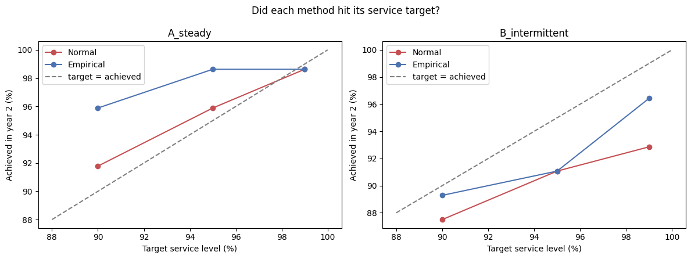
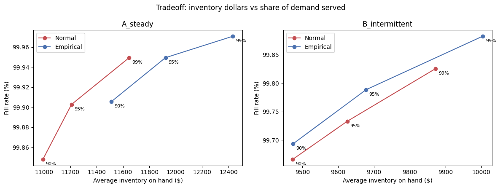

# Inventory policy and safety stock simulator

Python simulation comparing reorder policies for Walmart products using real daily sales data. The question: which policy gives the best balance between stockouts and inventory dollars, and does the textbook safety stock formula hold up for slow, irregular sellers?

## Data

[Walmart M5 Forecasting dataset](https://www.kaggle.com/competitions/m5-forecasting-accuracy) (Kaggle). Store CA_1, last 730 days of daily unit sales, plus weekly shelf prices.

- **Year 1 (365 days):** used to pick products and set policy parameters
- **Year 2 (365 days):** used only for testing, so policies never see the demand they're scored on

40 products total:
- **10 steady sellers:** highest volume, sold on 90%+ of days
- **30 intermittent sellers:** randomly sampled from products with zero sales on 40% to 60% of days

## Method

**1. Forecasting.** One-step-ahead comparison of naive, seasonal naive (same weekday last week), 28-day moving average, and simple exponential smoothing (alpha tuned on year 1). Scored with WAPE instead of MAPE, because MAPE is undefined on zero-demand days.

**2. Policy.** Each product uses an (s, Q) policy: when inventory position drops to the reorder point s, order Q units.
- Q = Economic Order Quantity: √(2DS/H)
- s is set two ways at 90%, 95%, and 99% service targets:
  - **Normal method:** s = μL + zσ√L (assumes bell-curve demand)
  - **Empirical method:** the 90th/95th/99th percentile of actual 7-day demand totals from year 1

**3. Simulation.** Daily simulation of year 2 using actual demand, with a 7-day lead time and lost sales when stock runs out. Measured: cycle service level (share of replenishment cycles with no stockout), fill rate, stockout days, average inventory $, holding plus ordering cost, and lost revenue.

**Assumptions:** 7-day fixed lead time, $25 per order, 25% yearly holding rate. These are stated assumptions, not Walmart's actual figures.

## Results

Test year: May 2015 to May 2016. Service results are pooled across all replenishment cycles in each group.

**Steady sellers (10 products, 73 replenishment cycles)**

| Method | Target | Achieved cycle service | Stockout cycles | Fill rate | Avg inventory $ | Lost revenue $ |
|---|---|---|---|---|---|---|
| Normal | 90% | 91.8% | 6 of 73 | 99.8% | 10,992 | 231 |
| Normal | 95% | 95.9% | 3 of 73 | 99.9% | 11,209 | 108 |
| Normal | 99% | 98.6% | 1 of 73 | 99.9% | 11,647 | 56 |
| Empirical | 90% | 95.9% | 3 of 73 | 99.9% | 11,513 | 105 |
| Empirical | 95% | 98.6% | 1 of 73 | 99.9% | 11,922 | 56 |
| Empirical | 99% | 98.6% | 1 of 73 | 100.0% | 12,434 | 32 |

**Intermittent sellers (30 products, 56 replenishment cycles)**

| Method | Target | Achieved cycle service | Stockout cycles | Fill rate | Avg inventory $ | Lost revenue $ |
|---|---|---|---|---|---|---|
| Normal | 90% | 87.5% | 7 of 56 | 99.7% | 9,473 | 100 |
| Normal | 95% | 91.1% | 5 of 56 | 99.7% | 9,625 | 80 |
| Normal | 99% | 92.9% | 4 of 56 | 99.8% | 9,872 | 51 |
| Empirical | 90% | 89.3% | 6 of 56 | 99.7% | 9,474 | 92 |
| Empirical | 95% | 91.1% | 5 of 56 | 99.8% | 9,678 | 62 |
| Empirical | 99% | 96.4% | 2 of 56 | 99.9% | 10,004 | 32 |

**Forecast error (WAPE, lower is better)**

| Method | Steady | Intermittent |
|---|---|---|
| Simple exponential smoothing | 35.0% | 96.8% |
| 28-day moving average | 35.7% | 96.2% |
| Seasonal naive | 38.0% | 115.4% |
| Naive | 39.8% | 115.2% |

**Findings:**
- **The textbook formula worked for steady sellers.** The normal method landed within 2 points of every target (91.8%, 95.9%, and 98.6% vs 90/95/99%). The empirical method overshot its 90% and 95% targets and held 6% more inventory at the 95% target ($11,922 vs $11,209).
- **The textbook formula fell short for intermittent sellers, and the gap grew with the target.** At 99% it achieved only 92.9%. The empirical method reached 96.4% at the same target with 1.3% more inventory ($10,004 vs $9,872). Both methods still missed their targets on these products. The sample is 56 cycles, so each stockout moves the result by about 2 points, and the differences between methods should be read as directional.
- **Service vs cost:** For steady sellers, raising the normal-method target from 90% to 99% added $655 (+6%) in average inventory and cut lost revenue by 76% ($231 to $56). The added holding cost (about $164 per year) roughly equals the lost revenue it saved, so a 99% target only pays off if margins or customer goodwill justify it.
- **Forecasting:** For steady sellers, exponential smoothing and a 28-day moving average both beat the naive forecast (35.0% and 35.7% WAPE vs 39.8%). For intermittent sellers, every method had a WAPE near or above 100%. Day-level forecasts are close to useless for these items, which is why the reorder point has to rely on lead-time demand totals instead.

## Limitations

- Fixed lead time. Variable lead times would need more safety stock.
- Sales data only shows what sold, not true demand on days the shelf was empty.
- Parameters are set once from year 1 and never updated.

## Next steps

- Test intermittent-demand methods (such as Croston's method) and a longer test period for more cycles
- Update s and Q monthly from the best forecast
- Add variable lead times
- Test a periodic review (order every R days) policy
- Scale from 15 products to a full department

## How to run

1. Download `sales_train_evaluation.csv`, `calendar.csv`, and `sell_prices.csv` from the Kaggle link above
2. Open `notebooks/inventory_policy_sim.ipynb` in Google Colab or Jupyter
3. Set `DATA_DIR` in the settings cell to the folder with the CSVs
4. Run all cells. Charts save to `figures/` and tables to `outputs/`

Tools: Python, pandas, NumPy, Matplotlib
